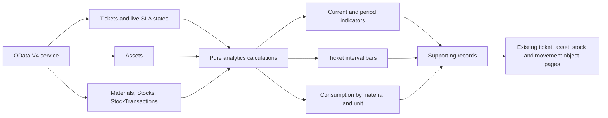

# Phase 9 — Management analytics contract

The **IT Operations Dashboard** reads the existing OData service. It does not
change business records or add a second database. A pure calculation module
(`ext/analytics/metrics.js`) produces the metrics, trends and supporting rows;
the Fiori page controller reads every page of five collections before publishing
the result. A failed collection read hides the dashboard and offers Refresh.

## Metric definitions

The default analysis period is the last 90 elapsed days. Users can choose 30,
90 or 365 days. All interval calculations use UTC and the last successful load
time. Changing the period recalculates the same loaded snapshot; Refresh reads
the service again. The UI shows the load timestamp. Reads are not a database-wide
transactional snapshot, so concurrent writes can span different request times.

| Indicator | Definition and supporting records |
| --- | --- |
| Open tickets | Current tickets whose status is neither RESOLVED nor CLOSED |
| Critical tickets | Open tickets with CRITICAL priority |
| SLA breaches | Open tickets with calculated SLAStatus BREACHED; each ticket counted once |
| Average response | Mean elapsed minutes from creation to first response for tickets created in the period with a valid completed first response |
| Average resolution | Mean current resolution-cycle elapsed minutes minus accumulated paused minutes, for currently RESOLVED/CLOSED tickets resolved in the period |
| Assets under repair | Current Assets with IN_REPAIR status |
| Warranty expiring | Assets except RETIRED/DISPOSED with WarrantyEnd from today's UTC date through 90 calendar days ahead, inclusive |
| High incident assets | Assets linked to at least two tickets created in the selected period |
| Low / out-of-stock locations | Stock records with AvailableQuantity at or below ReorderLevel; counts material/location records, not distinct materials |
| Inventory consumption | Count of ISSUE and RETURN movements in the period; quantities appear separately by material/unit below |

Averages show **No samples** when there is no qualifying record, rather than a
misleading zero. Missing first responses are excluded; in-progress time is not
treated as completed response or resolution time. Resolution uses the current
cycle after reopening, not an average of all historical resolution cycles.

Current workload, repairs, warranty and stock are unaffected by the period
selector. Warranty has its own forward-looking 90-day window. Equipment uses
the shared Assets records; it is never included in spare-part stock quantities.

## Trends and consumption

Ticket trends use consecutive seven-day intervals for 30/90-day selections and
30-day intervals for the 365-day selection. The final interval may be shorter.
Intervals include their start and exclude their end, except the last includes
the load time. Each event is counted once. Bars share a scale and retain numeric
links, so the information does not depend on color or bar length.

Created counts use CreatedAt. Resolved counts use ResolvedAt only for currently
completed tickets. These are event summaries of the current record snapshot,
not historical backlog, historical SLA snapshots or full reopen-cycle analytics.

Consumption groups by MaterialUUID and UnitOfMeasure. Issued and returned values
are summed in thousandths to avoid decimal drift. Net equals issued minus
returned. Returns can relate to issues before the selected period, so negative
net consumption is valid. Receipts, transfers, reservations and adjustments are
not consumption. There is no total that adds metres to pieces.

## Drill-downs

Each indicator opens its exact contributing records in the supporting-record
table. Average rows show their individual minute durations. Trend count links
open tickets within that interval. A material consumption link opens its issue
and return transactions for the period. Every record link routes to the existing
canonical object page; UUIDs, not display tags, identify navigation targets.

## Authorization and SAP continuation

The Phase 8 policy identifies Dashboard as an **IT Manager** page with
organization-wide operational reads. The mock remains an all-roles workbench:
navigation visibility is not authentication or server-side authorization.
Production must restrict source rows before aggregation and authorize each
drill-down. See the [planned CDS analytical views](../sap-design/analytics/README.md).

The local implementation loads source collections into browser memory. For a
production dataset, move aggregation and paging to the backend, select the
supported analytical exposure for the target ABAP release and preserve these
definitions. Do not infer live SAP analytical-engine compatibility from this page.
