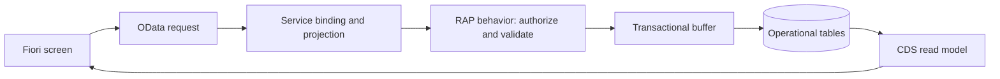

# Phase 10 — beginner's manual

Phase 10 designs the future SAP backend. The application still uses the local
mock service. You can inspect and validate the whole design without an SAP login;
activating ABAP objects requires the target SAP development system in Phase 11.

## 1. Understand the layers

| Term | Meaning in this project |
| --- | --- |
| Database table | Stores facts such as a ticket subject or physical stock quantity |
| CDS interface view | Gives those facts a business-facing shape and relationships |
| Business object (BO) | Groups a root and owned children, such as Ticket and its history |
| Behavior definition | Declares permitted operations and transaction rules |
| Action | A named business command, such as Submit or IssueReservation |
| Validation | Rejects an invalid command, such as issuing more than reserved |
| Determination | Supplies calculated or server-controlled values, such as timestamps |
| Projection | Selects the public view and operations exposed to the application |
| Service definition | Lists the public entities |
| Service binding | Makes that service available using OData V4 |



This is the target flow. Today, JavaScript mock handlers stand in for the SAP
behavior and persistence layers.

## 2. Open the design package

Start with [the package index](../sap-design/phase-10/README.md), then read
architecture, persistence and behavior. Use the field dictionary to look up a
single field. For example, TicketUUID is the technical key; TicketNumber is a
human-readable identifier. Do not use the displayed number as a foreign key.

The package covers 20 public entity sets. Nineteen have custom operational table
designs; Employees uses an approved external employee source. Additional technical
identity/numbering records are described separately in persistence.md.

## 3. Reproduce the local checks

Open a terminal in the main project folder. Use Node.js 24 and install the locked
dependencies if this is a fresh checkout:

```sh
npm ci
npm run design:check
npm run test:design
npm run pretest
```

`design:check` compares the design against the real mock metadata and role policy.
`test:design` runs 14 tests, including deliberately broken designs to prove the
validator rejects drift. `pretest` also checks the synchronized mock files and
service contract. These commands do not connect to SAP.

## 4. Follow one workflow through the layers

1. A technician opens a ticket and requests a quantity-tracked spare part.
2. Fiori invokes the ticket-bound RequestPart action with its published parameters.
3. The future backend authenticates the technician, checks scope and ticket/repair
   state, locks the related roots, and rereads stock availability.
4. It stages a reservation, increases reserved quantity and appends movement and
   ticket history in one transaction. Physical quantity has not decreased yet.
5. RequestPart returns **Ticket**, not Reservation. Refresh its related lists to
   see the new reservation.
6. MIS invokes IssueReservation. Physical and reserved quantities decrease by the
   issued amount, issued quantity increases, and an ISSUE movement records it.
7. If any required save fails, the whole command rolls back. A part issue must not
   leave a balance changed without its reservation and audit record.

An equipment receipt follows a different rule: each equipment unit gets a shared
Asset record. Cables and other quantity parts do not get individual asset tags.
The organization must approve the real number range and tag format before SAP use.

## 5. Maintain the design manually

1. Identify the affected entity/action in `mock/metadata.xml` and the role policy.
2. Make an intentional contract decision; do not change metadata just to silence a test.
3. Update the matching snapshot and mapping in
   `sap-design/phase-10/blueprint.json`, including storage, null handling, roles,
   locks and transaction writes. Update narrative rules when behavior changes.
4. Run `npm run design:render`. It regenerates the field dictionary, navigation map,
   action map, table template bundle and service template.
5. Run `npm run pretest` and inspect `git diff`. Do not edit generated files by hand;
   the next render would overwrite that edit.

## 6. Implement manually in SAP when access is available

Follow [the acceptance checklist](../sap-design/phase-10/acceptance.md) in order.
In ADT, create the development package and separate table objects, then interface
views, compositions, behavior definitions/implementations, projections and service
objects. Activate and test each dependency before moving to its consumers.

The `.example` files are design templates, not a complete paste-and-activate ABAP
application. Target-release syntax, query providers, nullable projections,
authorization and lock coordination still require implementation and SAP tests.

After publishing the nonproduction binding, export its metadata and compare it
with the package. Configure the frontend destination only after resolving action
namespaces, null handling and ETag behavior. Changing a proxy URL alone does not
rename OData actions. Run the acceptance matrix with separate users and concurrent
sessions before claiming SAP backend completion.
