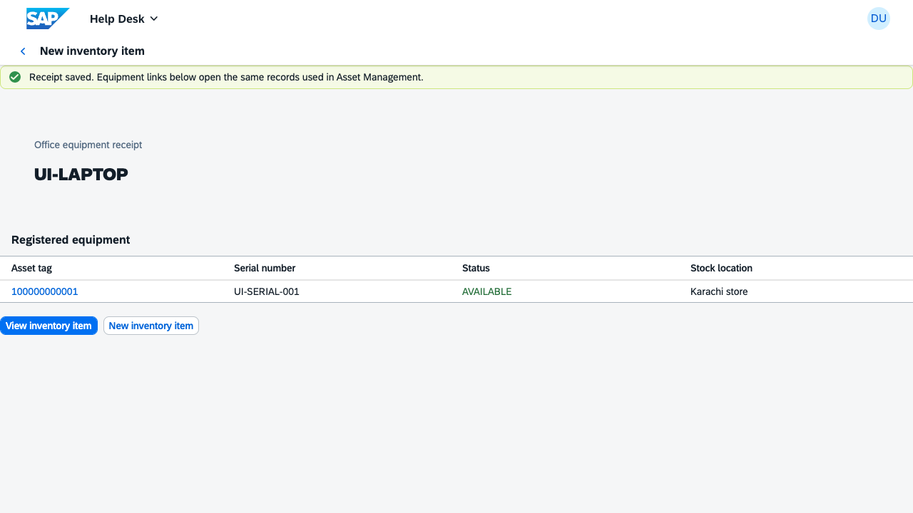
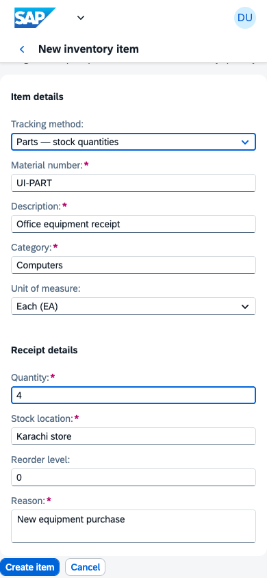

# Inventory item creation and shared assets — implementation report

Implemented locally on **9 October 2026**. The requested tracking rule is:
**tag equipment individually; track spare parts and cables by quantity**.

## Delivered

- **New inventory item** on MIS Inventory and Stock overview. The responsive form
  creates either an equipment model with individual units or a part with opening
  stock, reorder level and a receipt movement.
- **Receive equipment** on an equipment catalogue entry for additional deliveries
  of the same model. Serial numbers identify the new physical units.
- **Shared records:** every existing asset is linked to a catalogue material.
  Inventory's equipment table and Asset Management use the same AssetUUID. Asset
  details link back through **View inventory item**. Existing tags are preserved.
- **Automatic tags:** equipment receives server-allocated internal numbers from
  configured local demo ranges. New units start AVAILABLE and can immediately use
  the existing assignment, transfer, repair and retirement workflows.
- **Current counts:** registered and available equipment counts come from actual
  asset records. Equipment has no second quantity-stock balance that can drift.
- **Validation and consistency:** duplicate material/serial numbers, bad quantities,
  invalid dates and exhausted ranges are rejected. The shared queue serializes
  receipts. A journal rolls back partial material, asset, stock and audit writes.
- **Access design:** the two new receipt actions and the creation page are assigned
  to MIS / Store Officer, subject to receiving-location scope in the future backend.

## Main implementation files

| File | Responsibility |
| --- | --- |
| `mock/data/_catalogue.js` | Validated creation, receipt, transaction journal and equipment counts |
| `mock/data/_asset-numbering.js` | Company/class demo number ranges and allocation |
| `mock/data/Materials.js` | Catalogue action handlers and calculated reads |
| `mock/metadata.xml` | Actions, shared Material/Asset associations and numbering fields |
| `apps/help-desk/webapp/ext/inventory/InventoryItem.*` | Creation/receipt form and result navigation |
| `apps/help-desk/webapp/model/access-policy.json` | Page and action authorization design |
| `tests/catalogue.spec.cjs` | Receipt validation, concurrency, identity and rollback checks |
| `tests/catalogue-ui.spec.cjs` | Equipment round trip, repeated receipt, reload, mobile parts and error recovery |

The current baseline has **20 entity sets, 59 navigation properties, 136 seed
rows and 51 synchronized files**. There are **36 bound actions plus CreateTicket**.

## Verification

All **116 tests were verified passing across the regression run and targeted
reruns**. The full run recorded 115 passes and one older Help Desk browser startup
timeout before the application rendered. That test passed on rerun, alongside
both new inventory browser tests (3/3 passed). No application change was needed
for that startup timeout.

The nine new tests cover equipment identity and lifecycle, part opening receipts,
invalid input, concurrent allocation, duplicate receipts, range exhaustion,
rollback after failed inserts, desktop navigation/reload and mobile error recovery.
Build, doctor, mock synchronization, contract validation and whitespace checks
also passed. Desktop and mobile screenshots were visually reviewed; the mobile
form was checked at 390 pixels with no horizontal overflow.

## Use the feature

Open the preview on **localhost:8082**, select **MIS Inventory**, then
**New inventory item**. Choose the tracking method before entering the receipt.
Equipment needs one unique serial number for each unit; parts need a quantity.
Tags are assigned at save time, so users do not type them.

The [step-by-step guide](inventory-item-creation.md) includes both workflows,
the architecture diagram, demo number ranges, service contract and SAP migration
requirements.

## Scope

These are local mock receipts, not postings to a live SAP system. SAP number
assignment is configurable; the demo ranges are project choices and must be
replaced with the approved company/class configuration during integration. No
financial asset, valuation or procurement posting is created. Local records reset
with the mock fixtures. Production authorization and durable transactions remain
backend integration work.

No commit or push is included in this change. Existing Phase 7–8 work and the
unrelated local workspace settings remain in place.
