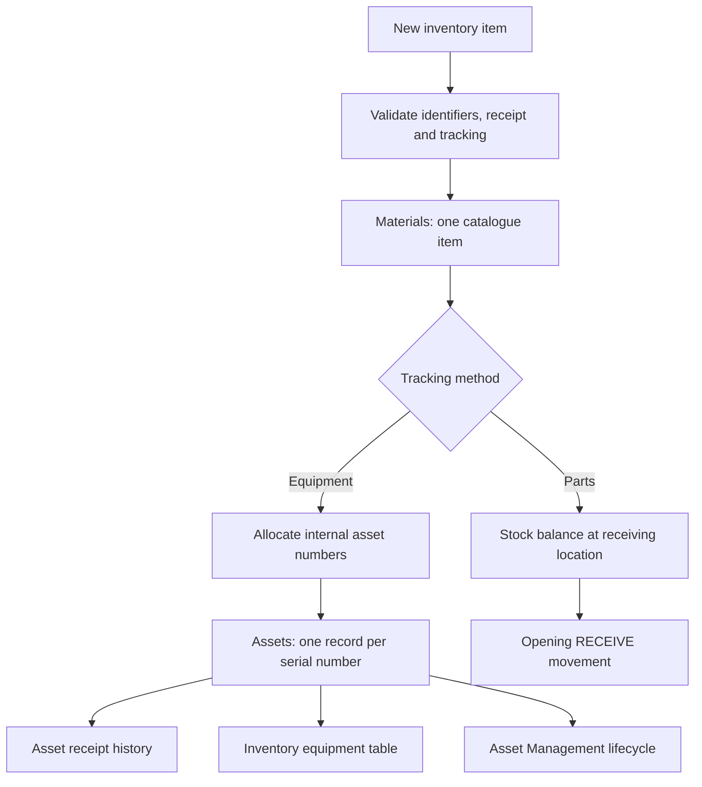

# New inventory items and shared equipment

MIS Inventory now supports creating catalogue items through **New inventory
item**. Equipment is registered once: its inventory page and Asset Management
refer to the same `Assets` record and UUID. Spare parts and cables remain
quantity-tracked, as requested.

## Create equipment step by step

1. Open the local preview on port 8082 and navigate to **MIS Inventory**.
2. Choose **New inventory item**.
3. Leave **Tracking method** as **Equipment — individual asset tags**.
4. Enter a unique material number, description and category. A material number
   identifies a model/product, not an individual physical unit.
5. Choose the equipment class, manufacturer and model. The unit is **EA**.
6. Enter the receipt quantity and receiving location.
7. Enter one serial number per unit, one per line. For two laptops, enter two
   serial numbers. The mock accepts up to 100 units in one receipt.
8. Enter purchase date, optional warranty end and a receipt reason.
9. Choose **Create item**. The server creates the catalogue entry and equipment
   records, assigns tags, and writes receipt history in one compensated operation.
10. Select a generated tag to open that exact asset in Asset Management. Choose
    **View inventory item** on the asset to return to its catalogue entry.

The equipment begins **AVAILABLE**. Use normal Asset Management actions to
assign, transfer, repair, return or retire it. Inventory's registered/available
equipment counts are calculated from those same asset records. Equipment is not
also counted in quantity-based Stocks, which would create two competing balances.

For another delivery of an existing equipment model, open its inventory detail
page and choose **Receive equipment**. Enter the new serial numbers, quantity,
location, dates and reason. This reuses the material and creates only new physical
units. Duplicate material numbers and duplicate serial numbers are rejected.

Existing equipment has been linked to six catalogue entries, preserving every
existing asset UUID, tag, assignment and repair link. Catalogue entries group
existing equipment by type, manufacturer and model.

## Create parts step by step

1. Choose **New inventory item**, then **Parts — stock quantities**.
2. Enter the material number, description and category.
3. Select **EA** for individual pieces or **M** for metres of cable.
4. Enter the positive opening quantity, storage location, nonnegative reorder
   level and receipt reason. EA quantities and reorder levels must be whole units;
   M permits up to three decimal places.
5. Choose **Create item**, then **View inventory item**.
6. Open its stock location. Subsequent deliveries use **Receive Stock**; existing
   reserve, issue, return, transfer and adjustment workflows continue to apply.

This creates a material, one stock location record and an opening RECEIVE
movement. It does not create asset records or tags. Additional location creation
for an existing quantity-tracked item remains outside this form's scope.

## Shared model and workflow

`Materials.Assets` and `Assets.Material` provide both directions of navigation.
`TotalAssets` counts all registered units including retired/disposed history;
`AvailableAssets` counts only AVAILABLE units. Assignment immediately changes the
computed available count without a separate inventory edit. Existing stock
quantities continue to reconcile to their movement ledger.

## Automatic tags and SAP numbering

SAP supports internal, consecutive asset numbering from configured ranges. The
range is assigned through asset class/company-code configuration; there is no
single universal SAP tag string. See SAP's
[Number assignment](https://help.sap.com/docs/SAP_ERP/b350210eef6443b6bb3a155840ff905c/c83dde531ed3424de10000000a174cb4.html)
and [Control Information](https://help.sap.com/docs/SAP_ERP/e054164e736046be90f4aec602391321/c23cde531ed3424de10000000a174cb4.html).

The local implementation demonstrates this pattern using company code **1000**,
12-digit internal numbers and subnumber **0000**. `AssetTag` displays the allocated
main number. These are project demo choices, not a claim that SAP mandates these
specific intervals or that a financial asset has been created in SAP.

| Equipment class | Demo asset class | Number interval |
| --- | --- | --- |
| Laptop | IT_LAPTOP | 100000000001–109999999999 |
| Desktop | IT_DESKTOP | 110000000001–119999999999 |
| Monitor | IT_MONITOR | 120000000001–129999999999 |
| Printer | IT_PRINTER | 130000000001–139999999999 |
| Network equipment | IT_NETWORK | 140000000001–149999999999 |
| Other equipment | IT_OTHER | 190000000001–199999999999 |

The backend chooses the number; a client-supplied tag cannot override it. The
shared write queue prevents concurrent duplicate allocation in this mock process.
Existing legacy tags remain unchanged and do not acquire invented SAP accounting
identifiers. Configuration lives in `mock/data/_asset-numbering.js`.

Before SAP integration, agree the actual company codes, asset classes, ranges,
inventory-label convention and whether an operational asset maps to equipment,
an FI-AA asset or both. Replace local allocation with the supported backend number
range mechanism for the target release, backend locking and persistent uniqueness.
Do not use a client counter or database MAX+1 as the production allocator.

## Service and authorization design

- `POST Materials/ITOperations.CreateInventoryItem` is a collection-bound action.
  It returns the created Material after saving the associated receipt.
- `POST Materials(uuid)/ITOperations.ReceiveEquipment` receives additional units.
- Direct mutation of Materials, Assets, Stocks and history remains protected.
- Both receipt operations are assigned to MIS / Store Officer in the access
  design. The production backend must enforce permitted receiving locations and
  serial/number uniqueness; the existing role preview is not enforcement.

Validation covers duplicate identifiers, valid dates, equipment whole-unit
quantities, matching serial counts, supported classes and exhausted number ranges.
The write journal compensates partial writes, including insertions that fail after
mutation. Local data and allocated demo numbers reset with the mock fixtures;
durable numbering, authentication and SAP posting are not part of this preview.
