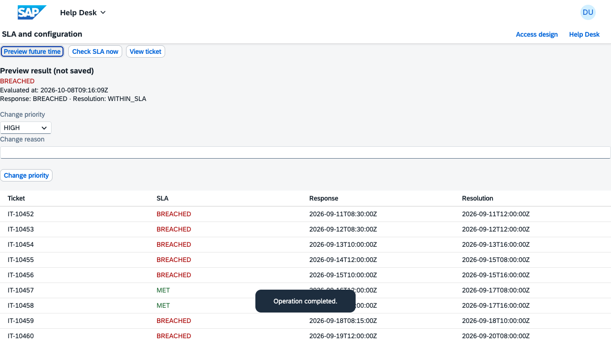
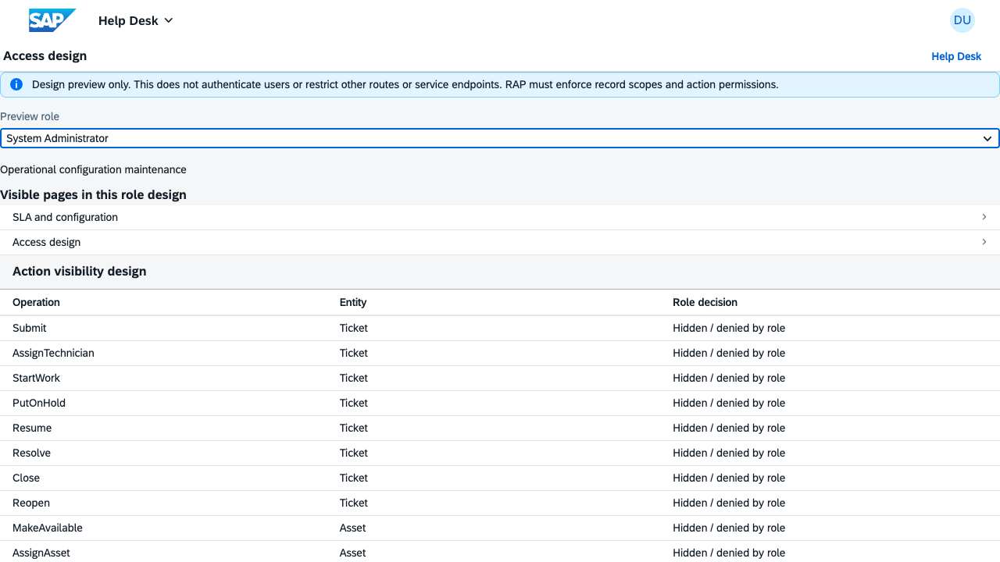
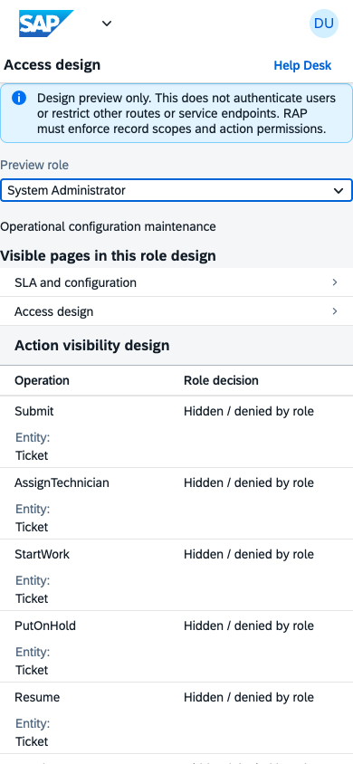

# Phases 7–8 completion report

Completed locally on **8 October 2026** using the requirements → implementation
→ automated verification → browser review → documentation workflow.

Phase 7 implements SLA, escalation and configuration in the local mock app.
Phase 8 completes the authorization **design**, as required by the phase plan;
production authentication and enforcement remain ABAP integration work.

## Phase 7: implemented behavior

- Tickets show response and resolution deadlines, SLA state and criticality.
  Policy targets are snapshotted when a ticket is created, so later policy edits
  do not silently change existing commitments.
- Assignment records the first response. Configured waiting reasons pause the
  resolution clock; resume accumulates paused time. Resolution stops that clock,
  and reopening starts a new resolution cycle.
- The SLA workbench projects a future timestamp without changing live data.
  An explicit Check SLA action applies enabled escalation rules and records
  history once per new escalation level.
- Priority changes require a reason, apply the current policy and retain elapsed
  time. Existing workflow transition and inventory safeguards remain in place.
- Seven configuration editors manage SLA policies, categories, subcategories,
  teams, locations, waiting reasons and escalation rules. Saves validate input
  and references, reject stale revisions and append before/after audit records.
  Failed audit writes roll back the associated configuration or ticket changes.
- Ticket creation uses active categories, optional matching subcategories,
  category default priority and team/location routing.

The contract now contains **20 entity sets, 57 navigation properties, 130 seed
records and 49 synchronized service files**. There are **34 bound actions plus
CreateTicket**. Canonical service files remain under `mock/`; the application
copy is produced by `npm run mock:sync`.

## Phase 8: authorization design

The machine-readable access policy and documented matrix cover seven roles:
Employee, Technician, Help Desk Supervisor, Asset Administrator, MIS / Store
Officer, IT Manager and System Administrator. All 20 entity sets, 35 operations
and 19 page targets have explicit policy entries.

The role explorer displays landing pages, permitted/denied actions and entity
read scopes for the selected role. The backend design specifies authenticated
actors, ownership/team/storage-location restrictions, CDS read controls, RAP
action authorization and future PFCG mapping. System Administrator is not given
every operational action automatically.

Selecting a role is an informational preview. It does not restrict navigation,
authenticate a user or prevent direct API calls in this local mock application.

## Verification results

The complete Playwright run finished with **107 passed** in approximately
2.8 minutes. No tests failed or were skipped in that run.

| Area | Passed | Main checks |
| --- | ---: | --- |
| Service contract | 63 | Entity fields, keys, queries and navigation |
| Asset workflows | 7 | Lifecycle, repairs, validation, concurrency and rollback |
| Ticket workflows | 6 | Creation, transitions, history and protected writes |
| Inventory workflows | 8 | Reservations, quantities, movements and integrated repair |
| SLA/configuration/access design | 13 | Exact warning/breach boundaries, waiting, reopen, snapshots, stale saves, escalation idempotence, rollback and policy coverage |
| Browser/preview | 10 | Existing workflows plus SLA simulation, audited policy editing and role explorer |
| **Total** | **107** | **Full regression suite** |

Mock synchronization, contract validation, doctor and production build also
passed. Browser screenshots were inspected; the role explorer was checked at a
390-pixel mobile viewport with no horizontal overflow. These results validate
the local implementation, not an SAP deployment.

### Visual evidence

## How to try it

1. Run `npm run preview` from the project root, or reuse the existing server.
2. Open `http://localhost:8082/test/flp.html#app-preview` and press **Go**.
3. Create a fresh ticket in **My IT Support**, then open the SLA/configuration
   workspace to inspect deadlines and simulate a future timestamp.
4. Edit a configuration record with a reason and inspect its revision/history.
5. Open the role-access preview and compare roles and their allowed actions.

Follow the [20-step beginner guide](beginner-guide-phases-7-8.md) for a complete
hands-on walkthrough and instructions to reproduce the implementation manually.
The [SLA workflow](sla-configuration-workflow.md) explains clock rules and
contains architectural/workflow diagrams. The
[authorization design](../sap-design/authorization/README.md) provides the full
role matrix and ABAP enforcement requirements. The root
[architecture guide](../PROJECT_ARCHITECTURE_AND_WORKFLOW.md) is updated too.

## Boundaries and next phase

Data is in memory and resets when fixtures reload or the server restarts. Actors
are synthetic. SLA clocks use elapsed calendar time; escalation runs through an
explicit action rather than a scheduler. Future-time preview projects the
current ticket snapshot and does not replay historical configuration changes.
Configuration editors update existing records; they do not create master data.

Phase 9 is analytics and the management dashboard. The SLA states, escalation
history, team/location routing and access policy now provide its input model.
This completion does not include a Git commit, push or SAP deployment.
