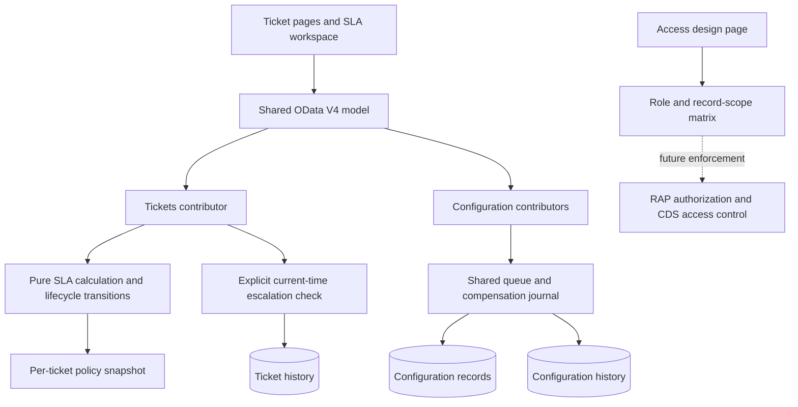
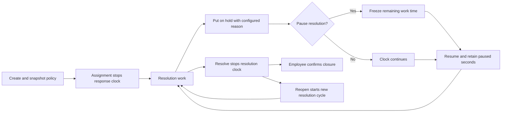

# Phases 7–8 — SLA, configuration and access design

SLA and configuration and Access design are modules of the existing Fiori app.
The service now has **20 sets, 57 navigation properties, 130 synthetic seed
records and 49 synchronized service files**. Real authentication and authorization
remain future SAP work.

## Policies and clocks

The defaults come from the original project design. They are configurable demo
targets, not an organizational service agreement.

| Priority | Response minutes | Resolution minutes | Warning consumed |
| --- | ---: | ---: | ---: |
| CRITICAL | 15 | 120 | 75% |
| HIGH | 30 | 240 | 75% |
| MEDIUM | 120 | 480 | 75% |
| LOW | 240 | 1,440 | 75% |

- Creation starts both clocks, including NEW tickets. AssignTechnician records
  FirstResponseAt once: this local definition treats assignment as acknowledgment.
- Resolve stops the resolution clock. Employee confirmation time is excluded.
- Reopen starts a new resolution cycle and resets escalation level; it preserves
  the original response result. A late first response remains a breach.
- Tickets snapshot response/resolution minutes, warning percentage and policy
  revision. Policy edits affect new tickets. ChangePriority explicitly applies
  the current selected-priority policy without resetting elapsed work or pauses.
- Reads calculate live statuses before query filtering and paging. Refresh/Go
  evaluates current time; there is no browser polling or background scheduler.
- A clock completed exactly at its deadline is MET. An unfinished clock is
  BREACHED at the deadline. AT_RISK starts at the warning percentage.
- Overall severity order is BREACHED, AT_RISK, PAUSED, WITHIN_SLA, MET. Criticality
  values are 1, 2, 5, 3, 3, with text displayed alongside color.
- These are elapsed-time clocks across nights/weekends. Business calendars,
  holidays and office-hours calculations are outside this milestone.

The resolution deadline adds the target, accumulated paused seconds and current
open pause to ResolutionStartedAt. WAIT_USER and WAIT_VENDOR pause resolution; WAIT_PARTS and
OTHER continue it. PutOnHold retains both the explanation and WaitingReasonCode.
Omitted codes use OTHER for compatibility. A pause beginning after breach does
not erase it. Editing a waiting rule does not alter an already-started interval.

## Preview and escalation

`Tickets(key)/ITOperations.PreviewSLA` accepts AsOf and projects the current
snapshot forward without writing records/history or changing the system clock.
It rejects invalid timestamps, dates before the latest ticket change, and dates
beyond 2100. It does not replay past transitions. Its result is shown separately
from the live ticket in the workspace.

`Tickets(key)/ITOperations.CheckSLA` evaluates current time. Active AT_RISK tickets
escalate to level 1/SUPERVISOR; active BREACHED tickets to level 2/IT_MANAGER.
Target and enabled state are configurable. EscalateSLA history is appended only
when the rule's level exceeds the recorded level; repeated checks are idempotent.
Escalation never automatically decreases. Resolved/closed tickets keep their SLA
results but do not newly escalate. A late response can drive overall escalation
while resolution is still within target.

This is a local explicit check, not a scheduled job, notification, email or
reassignment. SAP monitoring must apply equivalent rules with locking and audit.

## Configuration API

| Set | Rows | Editable fields |
| --- | ---: | --- |
| SLAPolicies | 4 | ResponseMinutes, ResolutionMinutes, WarningPercent |
| Categories | 8 | DefaultPriority, TeamUUID, Active |
| Subcategories | 8 | Name, Active |
| Teams | 2 | Name, LocationUUID, LeadUUID, Active |
| Locations | 2 | Name, Active |
| WaitingReasons | 4 | Name, PauseResolution, Active |
| EscalationRules | 2 | TargetRole, Active |
| ConfigurationHistory | 1 | Read-only before/after JSON, reason, revision, actor, time |

Each editable set exposes bound `Save<SetName>`, taking every editable field,
current Revision and mandatory Reason. Validation rejects invalid values and
references; stale revisions return 409. Successful writes increment Revision and
append history using the shared compensation journal. Direct POST/PATCH/DELETE
are blocked. Masters are seeded: creation and renaming stable codes/parent links
are not offered by this editor. Configuration actors are simulated as EMP-0006.

Category defaults supply priority when the client omits it and route new tickets
to the category's active team/location. My IT Support loads active categories and
matching subcategories, including Use category default for priority. Inactive
routing and mismatched subcategories are rejected. Existing routing is preserved.

## Ticket extension and SAP continuation

New fields cover routing UUIDs, policy snapshots, first response, resolution cycle,
paused time, waiting reason code, deadlines/statuses, evaluation time, escalation
level/target and last check/escalation time. Exact types are in `mock/metadata.xml`.
New ticket actions: PreviewSLA, CheckSLA and ChangePriority. PutOnHold gains optional
WaitingReasonCode. Client-supplied SLA snapshots/deadlines are ignored at creation.

The [authorization matrix](../sap-design/authorization/README.md) identifies every
entity, action and page target. Access design is a preview; it does not restrict
the mock API or globally hide operational actions. The UI states that boundary.

Proposed SAP persistence: ZIT_SLA_RULE, ZIT_CATEGORY, ZIT_SUBCATEGORY, ZIT_TEAM,
ZIT_LOCATION, ZIT_WAIT_REASON, ZIT_ESCALATION and ZIT_CONFIG_HISTORY. Validate names
and supported behavior against the actual SAP landscape. RAP must supply trusted
identity, filtered reads, global/instance permissions, concurrency, business checks
and atomic audits; the local compensation journal is not durable SAP persistence.
