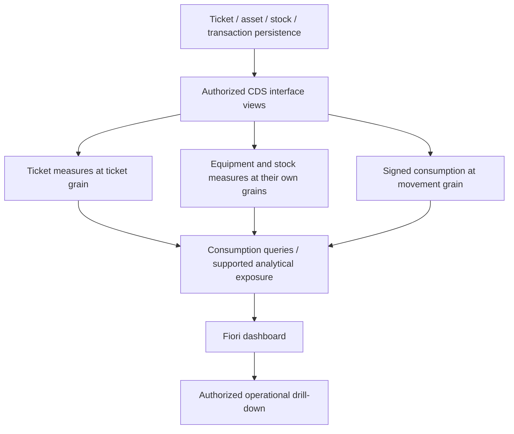

# Planned CDS analytical views — Phase 9 design

This is a design package, not activated ABAP or a deployed analytics service.
Confirm supported CDS view entities, analytical queries, units, annotations and
service exposure against the target SAP release during backend implementation.

| Proposed view | Grain | Measures / dimensions |
| --- | --- | --- |
| ZI_IT_TicketAnalytics | One ticket/current resolution cycle | Status, priority, team, category, creation/response/resolution timestamps, paused seconds, SLA state |
| ZI_IT_AssetAnalytics | One operational asset | Asset UUID/material UUID, lifecycle status, location, warranty date |
| ZI_IT_StockAnalytics | One material and storage location | Physical, reserved, available, reorder level, unit |
| ZI_IT_ConsumptionAnalytics | One stock transaction | Material, location, movement type, quantity, unit, creation time, ticket/repair references |
| ZC_IT_OperationsOverview | Authorized operational summary | Current open/critical/breached tickets, repair and low-stock counts, warranty window |
| ZC_IT_ServicePerformance | Period and service dimensions | Response sum/sample count; completed cycle duration sum/sample count; created/resolved event counts |
| ZC_IT_InventoryConsumption | Period, material, unit and location | Issued, returned and signed net quantity |

Names are project proposals. Keep distinct fact grains: joining comments,
assignments or stock movements directly to tickets before summing would multiply
ticket counts and durations. Preaggregate child facts or expose separate cubes.
Calculate averages as duration sum divided by sample count, never an unweighted
average of group averages. Associate quantity fields with their unit and prohibit
cross-unit totals.

## Backend acceptance

1. Apply authenticated read scopes before aggregation, including the allowed
   organization/team/location dimensions. Protect drill-downs independently.
2. Implement the exact definitions in the [analytics contract](../../docs/analytics-workflow.md),
   including current versus period metrics, warranty boundaries, reopened cycles,
   empty sample behavior, return signs and interval boundaries.
3. Preserve stable operational UUID keys in analytical details so the same Fiori
   object pages can open the underlying records.
4. Use backend-calculated SLA state at an explicit evaluation time. If historical
   SLA/backlog is later required, add immutable snapshots or a complete event
   model; today's mutable ticket row cannot reconstruct it reliably.
5. Choose the target release's supported aggregation/query protocol. The local
   dashboard performs aggregation in JavaScript and claims no OData $apply,
   analytical engine or generic analytical Fiori template support.
6. Reuse the calculation boundary cases from `tests/analytics.spec.cjs` as backend
   acceptance scenarios, then verify authorization, pagination and realistic
   volumes against the real service.

