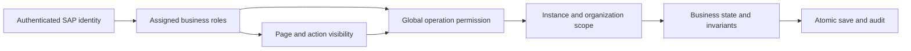

# Phase 8 — Roles and authorization design

Completed design for the local MVP, 8 October 2026. The interactive **Access design**
page previews page visibility, action decisions and entity read scopes for seven
roles. It does **not** log in, impersonate an authenticated user, change the global
application role, restrict direct routes, or enforce permissions in the mock API.
Operational pages remain available for testing all roles on one machine.

The machine-readable design is
[`access-policy.json`](../../apps/help-desk/webapp/model/access-policy.json).
Its coverage test requires an entry for every entity set, bound action and page target.
Permissions are explicit: a System Administrator does not inherit stock adjustment,
asset custody or ticket closure permission. Multi-role users receive the union of
explicit grants, still constrained by each record's scope and business state.

## Roles

| Role | Responsibility |
| --- | --- |
| Employee (`EMPLOYEE`) | Own tickets and assigned assets |
| Technician (`TECHNICIAN`) | Assigned tickets and related repair records |
| Help Desk Supervisor (`SUPERVISOR`) | Tickets and workload within managed teams |
| Asset Administrator (`ASSET_ADMIN`) | Asset custody and lifecycle |
| MIS / Store Officer (`STORE_OFFICER`) | Stock and reservation fulfilment |
| IT Manager (`IT_MANAGER`) | Organization-wide operational read access |
| System Administrator (`SYSTEM_ADMIN`) | Operational configuration maintenance |

## Action matrix

Inventory creation extension: `CreateInventoryItem` and `ReceiveEquipment` are
permitted for **MIS / Store Officer** only, within authorized receiving locations.
The `InventoryItem` page uses the same role. Store officers may read equipment in
their receiving locations as well as assets linked to store reservations.
Backend receipt authorization must cover all resulting material/stock/asset/audit
writes atomically, and number allocation must not be client-controlled. See the
[creation and numbering design](../../docs/inventory-item-creation.md).

Each row names the permitted roles. Every other role is denied by default.
Direct POST is allowed only for ticket creation; direct PATCH/DELETE on business
records and direct writes to audit/configuration collections remain forbidden.
These are the intended production authorization rules; mock write-protection
already exists, but role and record-scope enforcement does not.

| Action | Permitted roles | Required instance checks |
| --- | --- | --- |
| Submit | Employee | Authenticated requester owns this NEW ticket. |
| AssignTechnician | Help Desk Supervisor | Supervisor manages the ticket team; chosen technician must be eligible for that team. |
| StartWork | Technician | Authenticated technician is assigned to this ticket; enforce workflow and linked repair/parts constraints. |
| PutOnHold | Technician | Authenticated technician is assigned to this ticket; enforce workflow and linked repair/parts constraints. |
| Resume | Technician | Authenticated technician is assigned to this ticket; enforce workflow and linked repair/parts constraints. |
| Resolve | Technician | Authenticated technician is assigned to this ticket; enforce workflow and linked repair/parts constraints. |
| Close | Employee | Authenticated requester owns this RESOLVED ticket; CLOSED tickets cannot reopen in this MVP. |
| Reopen | Employee | Authenticated requester owns this RESOLVED ticket; CLOSED tickets cannot reopen in this MVP. |
| MakeAvailable | Asset Administrator | Validate role, record scope and current business state; reject direct field writes. |
| AssignAsset | Asset Administrator | Validate role, record scope and current business state; reject direct field writes. |
| TransferAsset | Asset Administrator | Validate role, record scope and current business state; reject direct field writes. |
| ReturnAsset | Asset Administrator | Validate role, record scope and current business state; reject direct field writes. |
| SendForRepair | Technician, Asset Administrator | Technician has assigned linked work, or asset administrator controls the asset; preserve repair and parts invariants. |
| CompleteRepair | Technician, Asset Administrator | Technician has assigned linked work, or asset administrator controls the asset; preserve repair and parts invariants. |
| RetireAsset | Asset Administrator | Validate role, record scope and current business state; reject direct field writes. |
| DisposeAsset | Asset Administrator | Validate role, record scope and current business state; reject direct field writes. |
| ReceiveStock | MIS / Store Officer | Store officer controls source and destination locations; validate quantities, references and mandatory reasons. |
| ReserveStock | Technician, MIS / Store Officer | Store officer controls location, or technician has assigned linked work; prevent oversubscription. |
| TransferStock | MIS / Store Officer | Store officer controls source and destination locations; validate quantities, references and mandatory reasons. |
| ReturnStock | MIS / Store Officer | Store officer controls source and destination locations; validate quantities, references and mandatory reasons. |
| AdjustStock | MIS / Store Officer | Store officer controls source and destination locations; validate quantities, references and mandatory reasons. |
| IssueReservation | MIS / Store Officer | Store officer controls source and destination locations; validate quantities, references and mandatory reasons. |
| CancelReservation | Technician, MIS / Store Officer | Store officer controls stock location, or technician owns the linked part request; cancel only outstanding quantity. |
| RequestPart | Technician | Authenticated technician is assigned to this ticket; enforce workflow and linked repair/parts constraints. |
| SaveSLAPolicies | System Administrator | Validate role, record scope and current business state; reject direct field writes. |
| SaveCategories | System Administrator | Validate role, record scope and current business state; reject direct field writes. |
| SaveSubcategories | System Administrator | Validate role, record scope and current business state; reject direct field writes. |
| SaveTeams | System Administrator | Validate role, record scope and current business state; reject direct field writes. |
| SaveLocations | System Administrator | Validate role, record scope and current business state; reject direct field writes. |
| SaveWaitingReasons | System Administrator | Validate role, record scope and current business state; reject direct field writes. |
| SaveEscalationRules | System Administrator | Validate role, record scope and current business state; reject direct field writes. |
| CheckSLA | Help Desk Supervisor, IT Manager | Technician reads assigned tickets, supervisor manages team tickets, manager reads all; only CheckSLA can write escalation history. |
| PreviewSLA | Technician, Help Desk Supervisor, IT Manager | Technician reads assigned tickets, supervisor manages team tickets, manager reads all; only CheckSLA can write escalation history. |
| ChangePriority | Help Desk Supervisor | Supervisor manages the ticket team; chosen technician must be eligible for that team. |
| CreateTicket | Employee | Requester must equal authenticated employee; use active configuration and assigned asset. |
| CreateInventoryItem | MIS / Store Officer | Validate receiving location, tracking mode and all receipt records; allocate equipment tags server-side. |
| ReceiveEquipment | MIS / Store Officer | Receive new serial numbers for an existing equipment material within permitted locations. |

## Entity read scopes

A missing role is denied. Child rows inherit their parent scope, including `$expand`,
key reads, counts, value help and search. A user must not gain access by changing a
UUID or using a child entity-set URL. Audit details are read-only.

| Entity set | Role and allowed scope |
| --- | --- |
| Employees | Employee: Own profile; Technician: Assigned requester and IT support directory; Help Desk Supervisor: Team directory; Asset Administrator: Custodian directory; MIS / Store Officer: Linked requesters; IT Manager: Operational directory; System Administrator: Team lead reference directory |
| Tickets | Employee: Own tickets and children; Technician: Assigned tickets and children; Help Desk Supervisor: Managed-team tickets and children; Asset Administrator: Tickets linked to managed assets; MIS / Store Officer: Tickets linked to store reservations; IT Manager: All operational tickets |
| Assets | Employee: Assigned assets and permitted own history; Technician: Assets linked to assigned work; Help Desk Supervisor: Assets linked to team work; Asset Administrator: All assets and children; MIS / Store Officer: Equipment in permitted receiving locations and assets linked to store reservations; IT Manager: All assets and children |
| TicketComments | Employee: Own tickets and children; Technician: Assigned tickets and children; Help Desk Supervisor: Managed-team tickets and children; Asset Administrator: Tickets linked to managed assets; MIS / Store Officer: Tickets linked to store reservations; IT Manager: All operational tickets |
| TicketHistory | Employee: Own tickets and children; Technician: Assigned tickets and children; Help Desk Supervisor: Managed-team tickets and children; Asset Administrator: Tickets linked to managed assets; MIS / Store Officer: Tickets linked to store reservations; IT Manager: All operational tickets |
| AssetAssignments | Employee: Assigned assets and permitted own history; Technician: Assets linked to assigned work; Help Desk Supervisor: Assets linked to team work; Asset Administrator: All assets and children; MIS / Store Officer: Assets linked to store reservations; IT Manager: All assets and children |
| AssetRepairs | Employee: Assigned assets and permitted own history; Technician: Assets linked to assigned work; Help Desk Supervisor: Assets linked to team work; Asset Administrator: All assets and children; MIS / Store Officer: Assets linked to store reservations; IT Manager: All assets and children |
| AssetHistory | Employee: Assigned assets and permitted own history; Technician: Assets linked to assigned work; Help Desk Supervisor: Assets linked to team work; Asset Administrator: All assets and children; MIS / Store Officer: Assets linked to store reservations; IT Manager: All assets and children |
| Materials | Technician: Stock availability and own part requests; Help Desk Supervisor: Team-related inventory; Asset Administrator: Parts linked to managed assets; MIS / Store Officer: All inventory; IT Manager: All inventory |
| Stocks | Technician: Stock availability and own part requests; Help Desk Supervisor: Team-related inventory; Asset Administrator: Parts linked to managed assets; MIS / Store Officer: All inventory; IT Manager: All inventory |
| Reservations | Technician: Stock availability and own part requests; Help Desk Supervisor: Team-related inventory; Asset Administrator: Parts linked to managed assets; MIS / Store Officer: All inventory; IT Manager: All inventory |
| StockTransactions | Technician: Stock availability and own part requests; Help Desk Supervisor: Team-related inventory; Asset Administrator: Parts linked to managed assets; MIS / Store Officer: All inventory; IT Manager: All inventory |
| SLAPolicies | System Administrator: All configuration; IT Manager: Read configuration; Help Desk Supervisor: Read operational rules; Technician: Read active operational references; Employee: Read active ticket-entry references |
| Categories | System Administrator: All configuration; IT Manager: Read configuration; Help Desk Supervisor: Read operational rules; Technician: Read active operational references; Employee: Read active ticket-entry references |
| Subcategories | System Administrator: All configuration; IT Manager: Read configuration; Help Desk Supervisor: Read operational rules; Technician: Read active operational references; Employee: Read active ticket-entry references |
| Teams | System Administrator: All configuration; IT Manager: Read configuration; Help Desk Supervisor: Read operational rules; Technician: Read active operational references; Employee: Read active ticket-entry references |
| Locations | System Administrator: All configuration; IT Manager: Read configuration; Help Desk Supervisor: Read operational rules; Technician: Read active operational references; Employee: Read active ticket-entry references |
| WaitingReasons | System Administrator: All configuration; IT Manager: Read configuration; Help Desk Supervisor: Read operational rules; Technician: Read active operational references; Employee: Read active ticket-entry references |
| EscalationRules | System Administrator: All configuration; IT Manager: Read configuration; Help Desk Supervisor: Read operational rules; Technician: Read active operational references; Employee: Read active ticket-entry references |
| ConfigurationHistory | System Administrator: All configuration changes; IT Manager: Read audit history |

## Page and action visibility

The additional `InventoryItem` page is available to MIS / Store Officer for
catalogue creation and equipment receipt. It follows permitted receiving-location
scope. Asset pages link back to the shared catalogue record.

| Page target | Eligible roles | Scope |
| --- | --- | --- |
| TicketsList | Employee, Technician, Help Desk Supervisor, Asset Administrator, MIS / Store Officer, IT Manager | Inherit Tickets row scope; nested pages also require access to their originating ticket. |
| TicketsObjectPage | Employee, Technician, Help Desk Supervisor, Asset Administrator, MIS / Store Officer, IT Manager | Inherit Tickets row scope; nested pages also require access to their originating ticket. |
| MySupport | Employee | Apply each contained action permission independently; page access does not grant write access. |
| RequesterObjectPage | Employee, Technician, Help Desk Supervisor, Asset Administrator, MIS / Store Officer, IT Manager | Inherit Tickets row scope; nested pages also require access to their originating ticket. |
| AssetObjectPage | Employee, Technician, Help Desk Supervisor, Asset Administrator, MIS / Store Officer, IT Manager | Inherit Tickets row scope; nested pages also require access to their originating ticket. |
| AssetsList | Employee, Technician, Help Desk Supervisor, Asset Administrator, MIS / Store Officer, IT Manager | Inherit Assets row scope; nested pages also require access to their originating ticket. |
| AssetsObjectPage | Employee, Technician, Help Desk Supervisor, Asset Administrator, MIS / Store Officer, IT Manager | Inherit Assets row scope; nested pages also require access to their originating ticket. |
| MyAssets | Employee | Apply each contained action permission independently; page access does not grant write access. |
| MaterialsList | Technician, Help Desk Supervisor, Asset Administrator, MIS / Store Officer, IT Manager | Inherit Materials row scope; nested pages also require access to their originating ticket. |
| MaterialsObjectPage | Technician, Help Desk Supervisor, Asset Administrator, MIS / Store Officer, IT Manager | Inherit Materials row scope; nested pages also require access to their originating ticket. |
| StocksList | Technician, Help Desk Supervisor, Asset Administrator, MIS / Store Officer, IT Manager | Inherit Stocks row scope; nested pages also require access to their originating ticket. |
| StocksObjectPage | Technician, Help Desk Supervisor, Asset Administrator, MIS / Store Officer, IT Manager | Inherit Stocks row scope; nested pages also require access to their originating ticket. |
| ReservationsList | Technician, Help Desk Supervisor, Asset Administrator, MIS / Store Officer, IT Manager | Inherit Reservations row scope; nested pages also require access to their originating ticket. |
| ReservationsObjectPage | Technician, Help Desk Supervisor, Asset Administrator, MIS / Store Officer, IT Manager | Inherit Reservations row scope; nested pages also require access to their originating ticket. |
| StockTransactionsList | Technician, Help Desk Supervisor, Asset Administrator, MIS / Store Officer, IT Manager | Inherit StockTransactions row scope; nested pages also require access to their originating ticket. |
| StockTransactionsObjectPage | Technician, Help Desk Supervisor, Asset Administrator, MIS / Store Officer, IT Manager | Inherit StockTransactions row scope; nested pages also require access to their originating ticket. |
| RepairWorkspace | Technician, MIS / Store Officer, Asset Administrator, Help Desk Supervisor, IT Manager | Apply each contained action permission independently; page access does not grant write access. |
| Operations | Technician, Help Desk Supervisor, IT Manager, System Administrator | Apply each contained action permission independently; page access does not grant write access. |
| RoleAccess | Employee, Technician, Help Desk Supervisor, Asset Administrator, MIS / Store Officer, IT Manager, System Administrator | Apply each contained action permission independently; page access does not grant write access. |

The entry-menu preview lists the normal landing pages for the selected role.
Related detail pages may also be reachable within the scopes above. Repair
workspace is shared: diagnosis/request/completion belong to eligible technicians
or asset administrators; issue belongs to the store officer. Operations is shared:
SLA reads are broader than CheckSLA; only System Administrator saves configuration.
The page preview exposes those distinctions; operational pages are not yet gated.

## Backend authorization requirements

1. Resolve the employee and business roles from trusted SAP identity. Never accept
   requester, actor, role, team ownership or stock-location ownership from an
   untrusted request body or a preview dropdown.
2. Define organization assignments absent from today's fixtures: user-to-team,
   supervisor-to-managed-team, technician eligibility and officer-to-stock-location.
   Validate both source and destination on transfers. The current Team.LeadUUID is
   configuration context, not a complete authorization assignment model.
3. Filter reads before paging/count/search/expansion. Check individual key reads
   and navigation. Minimize employee and history data exposed through value help.
4. Check both global action permission and instance ownership in behavior logic.
   Recheck at save time alongside locks, ETags and business-state validation.
5. Keep configuration maintenance separate from operational permissions. Protect
   audit insertion and rollback as internal operations; never expose editable audit rows.
6. Record the real actor, UTC time, reason and before/after values on authorized writes.
   Failed or rejected operations must not leave partial stock, SLA or history changes.
7. Return authorization errors consistently; do not reveal sensitive record data in
   errors. Hiding an action is a usability feature, never an authorization boundary.

## RAP / PFCG continuation

Proposed role names (validate against the target landscape): Z_IT_EMPLOYEE,
Z_IT_TECHNICIAN, Z_IT_SUPERVISOR, Z_IT_ASSET_ADMIN, Z_IT_STORE_OFFICER,
Z_IT_MANAGER and Z_IT_SYSTEM_ADMIN. Design authorization objects/fields for
activity, team, location and business scope; use the target system's supported
business-role/PFCG mechanism to assign them.

Map entity read scopes into the selected CDS access-control design. Map global and
instance action decisions into RAP authorization checks. Feature availability
should combine authorization with workflow eligibility, while behavior code repeats
all critical checks. Configuration revisions remain concurrency tokens, not proof
of permission. Verify the generated OData capabilities and action availability in
Fiori after implementing RAP. This repository supplies requirements and test cases,
not deployable PFCG roles, CDS DCL or ABAP behavior implementations.

## Required authorization acceptance cases

- Employee A cannot read, count, expand, close or reopen Employee B's ticket.
- A technician cannot mutate another technician's work or invent a repair reference.
- A supervisor cannot assign or change priority outside a managed team.
- A store officer cannot issue or transfer outside authorized locations.
- An asset administrator cannot close an employee ticket solely through that role.
- A manager can monitor and check SLA but cannot change configuration or stock.
- A system administrator can maintain policies but cannot issue stock solely through
  that role; combining roles grants only the relevant additional operations.
- A forbidden action stays forbidden through a direct OData request even if a user
  reveals its hidden button. Test CSRF/session behavior and deployment role mappings
  separately in the real SAP environment.

Phase 12 implements these authorization requirements. Phase 9 adds management
analytics; this design already assigns its intended read audience to IT Manager.
