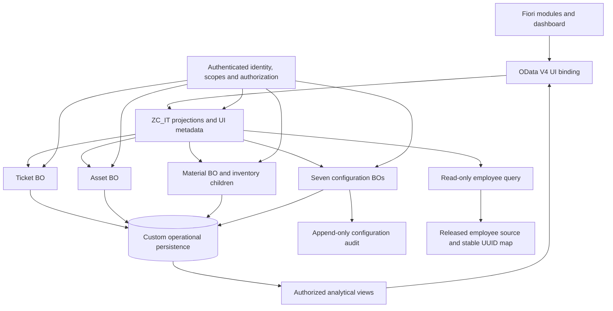

# Architecture and implementation decisions

## Chosen baseline

Use custom operational persistence with RAP managed business objects and active,
non-draft operations. Public updates are action-driven; only Tickets permits
standard create. Do not expose generic PATCH/DELETE or child create just because
the managed implementation uses them internally. Draft would add keys, actions
and lifecycle semantics absent from today's UI; adopting it requires a separate
contract decision, migration and acceptance suite.

The baseline does not post FI-AA acquisitions or MM goods movements. Assets are
operational IT equipment; parts are operational store balances. An organization
that requires standard SAP stock or fixed-asset ownership must choose released
APIs and their transaction model before implementing persistence. Never operate
two independent authoritative stock balances for the same inventory.

## Ownership and public access

| Root | Composition children | Public mutation boundary |
| --- | --- | --- |
| Tickets | TicketComments, TicketHistory | Standard ticket create and ticket actions; comments/history read-only externally |
| Assets | AssetAssignments, AssetRepairs, AssetHistory | Asset actions; creation only inside equipment receipt |
| Materials | Stocks, Reservations, StockTransactions | Collection CreateInventoryItem, ReceiveEquipment and child inventory actions |
| SLAPolicies, Categories, Subcategories, Teams, Locations, WaitingReasons, EscalationRules | None | Corresponding Save action only; provisioning is a controlled administrative migration |
| ConfigurationHistory | None | Read-only service exposure; internal audit writer only |
| Employees | None | Read-only released source/query; no duplicated editable HR master |

An Asset has a Material association, **not** a second composition parent. An
AssetRepair belongs to its Asset; its Ticket is an association. A Reservation
belongs to Material even when initiated by a ticket. The complete navigation map
distinguishes inverse query associations from ownership. Direct child-set reads
must apply the parent's authorization scope just as navigation reads do.

Seven configuration roots plus Ticket, Asset and Material own their own locks.
ConfigurationHistory is an append-only audit resource with generated UUIDs, not
an editable configuration root. Material-wide locks serialize inventory for a
material across locations; this is deliberately conservative. A later stock-level
BO split would require a new transaction/ownership design and load testing.

## Implementation layers

- `ZI_IT_*`: typed interface views and ownership/associations. Make all public
  computed fields available to filtering/ordering before paging where supported.
- `ZC_IT_*`: service projections with redirected associations and curated
  behaviors. Public set aliases are specified by `service.srvd.example`.
- Behavior pools: action guards, authenticated actor, feature control,
  determinations and save validations. Internal writes remain private to the BO;
  never expose an unrestricted generic update endpoint to make orchestration easy.
- Domain helpers: decimal arithmetic, SLA evaluation, numbering, audit assembly,
  and cross-BO orchestration. No database commit or remote irreversible posting
  from a handler. See [transaction design](transactions.md).
- CDS access control/query filtering: authorized rows before counts, sorting,
  aggregation or paging. Role visibility and Can* fields are UX hints only.

## Release and landscape gates before Phase 11 activation

| Gate | Required decision/evidence | Responsible role |
| --- | --- | --- |
| ABAP landscape | Product, exact release, ADT version, supported strict mode, CDS and OData V4 UI binding | SAP platform owner |
| Master sources | Released employee/user source, identity mapping and allowed technician/team data | Identity and functional owners |
| Persistence authority | Approve operational custom stores, or select released FI-AA/MM integration and revise adapter/transaction plan | Asset/store owners |
| Service compatibility | Capture generated metadata; prove nulls, precision, aliases, action return shapes, filtering and ETags | Backend/frontend developers |
| Numbering | Approved company/class scopes, intervals, authorization and integration distinction | Asset/finance owners |
| Security | Organizational scopes, identity-to-employee mapping, role grants and audit retention | Security owner |

These are environment inputs and activation gates, not missing mock features.
The domain relationships and workflow remain defined while the generated SAP
namespace, concrete released sources and organization-approved intervals await
the actual system.
