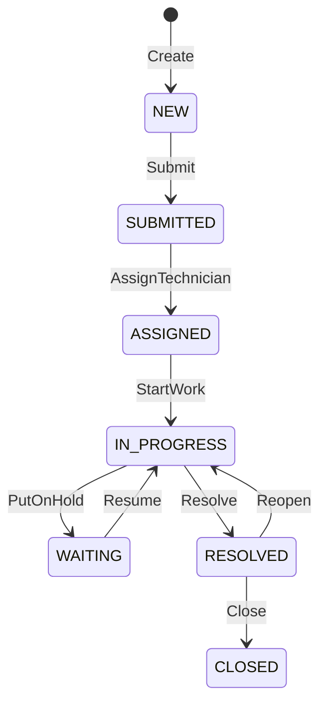

# RAP behavior and domain rules

The generated [action map](action-map.md) contains every binding, parameter facet,
return type, role/scope, potential write set and guard. This document specifies
the shared behavior contract. Public operations are the existing 36 bound actions
plus standard POST /Tickets. There is no public CreateTicket action import and
no comment-create endpoint in the current contract.

## Ticket creation and workflow

Allow creation inputs Subject, Description, Category, optional Priority,
RequesterUUID, optional AssetUUID and SubcategoryUUID. Resolve authenticated
employee first: RequesterUUID must match that identity, rather than trusting a
browser-selected employee. Reject unauthorized on-behalf-of creation. Ignore or
reject client-supplied identifiers, status, SLA/audit fields consistently at the
service boundary; the implementation must never persist them as trusted values.
Validate required text lengths and active configuration, category/subcategory
relationship, routing team/location, and current custody of any affected asset.

Creation produces NEW, server UUID/number, server actor/time, SLA/routing snapshot
and Create history in one transaction. My IT Support subsequently invokes Submit;
create is not implicitly SUBMITTED. Preserve this two-step contract.

AssignTechnician requires an eligible technician in the permitted team scope;
the mock's Department check is not a substitute for production eligibility.
PutOnHold requires a reason and a valid active waiting code, default OTHER when
omitted. Resolve requires resolution text, no open linked repair and no OPEN or
PARTIAL linked reservation. Reopen requires a reason and clears resolution/closed
timestamps, starts a new resolution cycle and preserves first response. CLOSED
cannot be reopened in this contract. Repeat transition attempts fail rather than
silently appending duplicate history.

## Equipment and inventory

The asset state guards are recorded per action. Every custody change checks the
current open assignment against CurrentEmployeeUUID. Transfer ends the old
interval and starts the new at one UTC instant. Return closes custody. Repair
preserves custody; completion returns to ASSIGNED if custody exists, AVAILABLE
otherwise. CompleteRepair requires completion text and no outstanding requests
for that repair. Retirement/disposal retain all historical rows.

All stock commands validate decimal precision, units, positive quantity except
signed nonzero AdjustStock, mandatory reason and location scope. Reservations
and transactions must agree on material, stock, ticket, asset and repair.

| Operation | Balance and result semantics |
| --- | --- |
| ReceiveStock | Physical +q, reserved unchanged; RECEIVE event |
| ReserveStock / RequestPart | Reserved +q; new reservation and RESERVE event; ticket-linked history when applicable |
| IssueReservation | Physical -q, reserved -q, issued +q; PARTIAL/FULFILLED from remainder; ISSUE event |
| CancelReservation | Reserved minus unissued remainder; CANCELLED; CANCEL event; retain issued history |
| TransferStock | Source physical -q, destination +q, no reserved change; two opposite events sharing TransferUUID |
| ReturnStock | Physical +q; original ISSUE and cumulative return ceiling validated under lock; RETURN links OriginalTransactionUUID; do not reopen reservation or reduce original IssuedQuantity |
| AdjustStock | Signed physical delta; require resulting physical >= reserved; ADJUST event |

The return type is not always the object created: ReserveStock returns Stock;
RequestPart returns Ticket. Their new reservations are found through navigation
refresh. Do not change these returns to Reservation because that seems convenient.
Equipment receipts return Material, then its Assets collection is refreshed.

## SLA and configuration

Implement the [SLA contract](../../docs/sla-configuration-workflow.md), using one
captured evaluation instant per read/query. Assignment records first response
once; waiting/resume updates pause accumulation; resolution stops its cycle.
Completed exactly at deadline is MET; incomplete at deadline is BREACHED.
Do not recompute different timestamps for filtering and final row projection.

PreviewSLA remains a POST action for wire compatibility but is read-only: no
history, ETag, escalation or database change. CheckSLA records its check and
escalates only to a higher configured level; retries do not duplicate escalation
history. External notifications/scheduler delivery are later-phase work.
ChangePriority snapshots the selected policy while preserving elapsed time.

Save* actions accept only their exact published parameters. Revision is an
expected version, not a value clients may set arbitrarily. Validate bounds and
active references, compare Revision under lock, increment it and append a single
ConfigurationHistory record with before/after JSON and reason. Reject stale
revisions; never overwrite or erase audit. Configuration changes affect new
snapshots; do not retroactively rewrite old ticket targets.

## Determinations, validation and feature control

| Stage | Required work |
| --- | --- |
| Request boundary | Authenticate, resolve actor, reject forbidden fields/actions; parse types and sizes |
| Before staging changes | Scope authorization, feature/state guards, references, quantity/text rules, immutable code fields |
| Interaction phase | Acquire required locks, reread mutable dependencies, stage root/children, assign IDs, timestamps, numbers and audit |
| Before save | Recheck cross-record invariants using the transactional buffer: stock >= reservations, one custody/repair, matching references, required audit, uniqueness |
| Commit response | Return the published entity shape, computed values and current ETag; request side-effect refresh of changed collections |

Can* reflects state **and** current user's permitted action, but the action handler
must repeat authorization and validation. Recompute derived status/criticality
and stock values from facts. Do not persist a user's feature flags globally.
Backend errors use RAP `failed`/`reported` with field targets and safe messages;
do not leak records from a denied organizational scope through error details.

The private implementation can support internal create/update/create-by-association
while public projection behavior exposes only approved operations. Audit child
updates/deletes remain denied even to administrators. SAP's behavior and action
contracts describe the implementation model and error reporting; the concrete
design here is project-specific. Sources: [behavior definitions](https://help.sap.com/docs/abap-cloud/abap-rap/defining-and-implementing-behavior-of-business-object),
[action contract](https://help.sap.com/docs/abap-cloud/abap-rap/implementation-contract-action).
